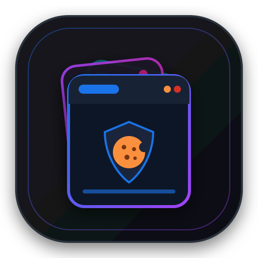
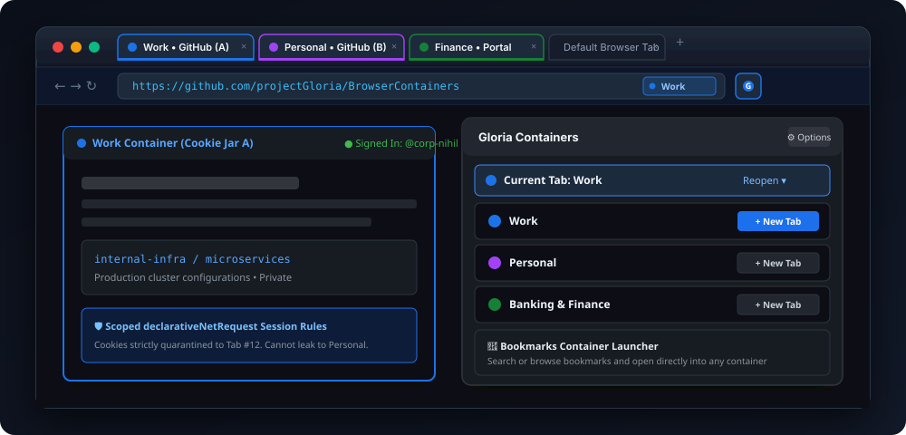
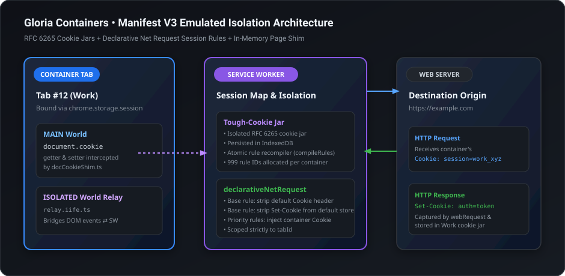

<div align="center">



# Gloria Containers

**Firefox-style multi-account tab & cookie isolation crafted for Chromium**

*Isolate web logins, quarantine trackers, and customize identities with dedicated cookie jars — built for Manifest V3.*

<p>
  <a href="LICENSE"></a>
  
  
  
  
  
</p>

---

<p>
  <a href="#-about-gloria-containers">About</a> •
  <a href="#-key-features">Features</a> •
  <a href="#-architecture--how-isolation-works">Architecture</a> •
  <a href="#-visual-tour">Visual Tour</a> •
  <a href="#-installation--setup">Installation</a> •
  <a href="#-known-limitations--read-these">Limitations</a> •
  <a href="#-manual-test-checklist">Testing</a> •
  <a href="#-license">License</a>
</p>

<p align="center">
  
</p>

</div>

---

## 🗂️ About Gloria Containers

Firefox's **Multi-Account Containers** is widely regarded as one of the finest privacy and multitasking innovations in modern web browsing. It allows users to segment their online lives into isolated color-coded contexts — keeping work logins, personal identities, social networks, and banking sessions completely quarantined from each other without juggling separate browser windows or resource-heavy profiles.

Chromium browsers lack native `contextualIdentities` APIs. **Gloria Containers** bridges this gap for Chromium-based browsers (including **Ungoogled Chromium**, Brave, and Chrome) through an emulated Manifest V3 isolation engine.

Rather than relying on sluggish profile restarts, Gloria Containers orchestrates:
- 🍪 **True Cookie Jar Separation**: Every container operates with its own independent, RFC 6265 compliant cookie jar powered by `tough-cookie` and persisted locally in IndexedDB.
- 🎨 **Bespoke Visual Customization**: Personalize each container with custom names, Chromium-native tab group colors, or your own uploaded images. Any image (PNG, JPEG, WebP, AVIF, GIF, SVG, BMP, ICO) is automatically center-cropped and downscaled to crisp 16/32/48/128 icons.
- 🏷️ **Tab Group Harmony**: Containers optionally reflect as native Chromium tab groups with matching swatches, keeping your tab strip clean and organized.
- 🔒 **Privacy-First & Local**: Zero telemetry, zero cloud synchronization, and zero third-party dependencies. All state resides strictly inside your browser's local sandbox.

---

## ✨ Key Features

<table>
  <tr>
    <td width="50%">
      <h3>🍪 Isolated Cookie Jars</h3>
      <p>Log in to multiple accounts on the same site simultaneously across adjacent tabs without credential cross-contamination.</p>
    </td>
    <td width="50%">
      <h3>🎨 Custom Icons from Any Image</h3>
      <p>Upload any picture up to 25 MB / 16384 px. The built-in image processor center-crops and scales it to crisp multi-density icons.</p>
    </td>
  </tr>
  <tr>
    <td width="50%">
      <h3>🏷️ Native Tab Group Integration</h3>
      <p>Containers can automatically map to Chromium tab groups, styling tabs with color swatches and clear categorical labels.</p>
    </td>
    <td width="50%">
      <h3>🖱️ Right-Click Context Menus</h3>
      <p>Instantly <em>"Open link in container → [Name]"</em> or <em>"Reopen this page in container → [Name] / No container"</em> anywhere on the web.</p>
    </td>
  </tr>
  <tr>
    <td width="50%">
      <h3>🔖 Integrated Bookmark Picker</h3>
      <p>Search and browse your bookmarks tree straight from the extension popup, launching selected sites directly into target containers.</p>
    </td>
    <td width="50%">
      <h3>⚡ Declarative Net Request Engine</h3>
      <p>High-performance Manifest V3 network session rules atomically strip default store cookies and inject container-scoped cookies per tab.</p>
    </td>
  </tr>
</table>

---

## 🏗️ Architecture & How Isolation Works

Because Chromium does not expose a native container API, Gloria Containers achieves airtight cookie isolation via coordinated subsystems:

| Layer | Responsibility | Key Source Files |
| :--- | :--- | :--- |
| **Tab Binding** | Tracks `tabId ↔ containerId` relationships in session storage | [`src/background/tabRegistry.ts`](file:///c:/Users/Nihil/Desktop/Gloria%20Repoz/BrowserContainers/src/background/tabRegistry.ts) |
| **Cookie Jar** | RFC 6265 cookie jar implementation persisted in IndexedDB | [`src/background/isolation/cookieJar.ts`](file:///c:/Users/Nihil/Desktop/Gloria%20Repoz/BrowserContainers/src/background/isolation/cookieJar.ts) |
| **Rule Compiler** | Translates jar cookies into `declarativeNetRequest` session rules | [`src/background/isolation/compileRules.ts`](file:///c:/Users/Nihil/Desktop/Gloria%20Repoz/BrowserContainers/src/background/isolation/compileRules.ts) |
| **Network Interception** | Captures incoming `Set-Cookie` headers via `webRequest` | [`src/background/isolation/cookieFlow.ts`](file:///c:/Users/Nihil/Desktop/Gloria%20Repoz/BrowserContainers/src/background/isolation/cookieFlow.ts) |
| **DOM Relay & Shim** | Bridges `document.cookie` reads/writes between MAIN world & Service Worker | [`src/background/isolation/docCookieShim.ts`](file:///c:/Users/Nihil/Desktop/Gloria%20Repoz/BrowserContainers/src/background/isolation/docCookieShim.ts) + [`src/content/relay.iife.ts`](file:///c:/Users/Nihil/Desktop/Gloria%20Repoz/BrowserContainers/src/content/relay.iife.ts) |

### Request Lifecycle in a Container Tab

<p align="center">
  
</p>

1. **Quarantine Base Rules**: When a tab joins a container, a baseline declarative rule strips outgoing `Cookie` headers to prevent default-profile cookies from leaking into the container. Symmetrically, incoming `Set-Cookie` headers are stripped from reaching the default cookie store.
2. **Prioritized Injections**: High-priority session rules dynamically inject the container's own cookie values into outgoing HTTP requests, differentiated by scheme, host-only vs domain, path, and `SameSite` context.
3. **Atomic Rule Allocation**: Each container is allocated an isolated block of 999 DNR rule IDs. Rule updates are coalesced and committed atomically to avoid race conditions.
4. **Inheritance**: New tabs spawned from a container tab (`Ctrl+click`, `target="_blank"`, `window.open`) automatically inherit the parent's container context.

---

## 📸 Visual Tour

### 1. Dual-Identity Workspaces
Run personal and organizational accounts side-by-side without private/incognito compromises or profile switching.

```
┌──────────────────────────────────────┐  ┌──────────────────────────────────────┐
│  Work Container (Blue Swatch)        │  │  Personal Container (Purple Swatch)  │
│  github.com/org-enterprise           │  │  github.com/my-open-source           │
│  ● Signed In as: @lead-dev           │  │  ● Signed In as: @nihil-personal     │
└──────────────────────────────────────┘  └──────────────────────────────────────┘
```

### 2. Context Menu Control
Right-click any link or page to seamlessly dispatch it into any configured container:

```
Right-Click Link
 └── Open link in container ────────► 💼 Work
                                      🏠 Personal
                                      💳 Banking & Shopping
                                      🧪 Research / Staging
```

### 3. Integrated Bookmark Launchpad
Open bookmarks directly into your designated container from the toolbar popup search:

```
[ Search Bookmarks...           🔍 ]
 ├── 💼 Jira Dashboard ────────► [ Open in Work ]
 ├── 🏠 Reddit Feed     ────────► [ Open in Personal ]
 └── 💳 Banking Portal  ────────► [ Open in Banking ]
```

---

## 🚀 Installation & Setup

### Prerequisites
- **Node.js** (v20+ recommended)
- **Chromium-based Browser** (Chrome 120+, Ungoogled Chromium, Edge, Brave, or Vivaldi)

### Building from Source

1. **Clone the repository:**
   ```bash
   git clone https://github.com/projectGloria/BrowserContainers.git
   cd BrowserContainers
   ```

2. **Install dependencies:**
   ```bash
   npm ci
   ```

3. **Build the extension:**
   ```bash
   npm run build
   ```
   *The compiled Manifest V3 extension bundle will be output to the `dist/` directory.*

4. **Load into your browser:**
   - Navigate to `chrome://extensions`.
   - Enable **Developer mode** (toggle in the top-right corner).
   - Click **Load unpacked**.
   - Select the `dist/` directory inside this repository.

### Developer Commands

```bash
# Start Vite development server with CRXJS hot reloading
npm run dev

# Run TypeScript typechecks without emitting files
npm run typecheck

# Run Vitest test suite (rule compiler & icon geometry tests)
npm test
```

---

## ⚠️ Known Limitations — Read These

Because Chromium provides no native container boundaries, the emulated architecture has inherent design boundaries:

- **Only cookies are isolated**: `localStorage`, `sessionStorage`, IndexedDB, Cache Storage, service workers, and the HTTP disk cache remain shared per-origin across containers. SPAs that store authentication tokens in `localStorage` rather than cookies will share sessions across containers.
- **Background & Prefetch Requests**: Requests originating without a tab (`tabId === -1`), including prefetching and background service workers, route through the default cookie jar.
- **Best-Effort `document.cookie` Shim**: Injected via `injectImmediately` at navigation commit. While it almost always loads before page scripts, inline scripts executing instantaneously on raw HTML may momentarily observe default store cookies.
- **Inherited Tab First Request**: If a link-opened tab's very first HTTP request leaves before DNR rules bind to the new `tabId`, the extension re-navigates the tab cleanly within the container.
- **Tab Groups Persistence**: Chromium natively saves tab groups. Deleting a closed group deletes the saved Chromium group, but never deletes your Gloria Container. Restoring a previously saved group will open tabs under the default cookie store.
- **Session Lifetime**: Tab-to-container bindings reside in `chrome.storage.session`. When the browser restarts, restored tabs open as default tabs, though all container cookie jars remain securely persisted in IndexedDB.

---

## 🧪 Manual Test Checklist

Before submitting PRs or deploying updates, verify the core isolation guarantees:

1. **Custom Icons & Visuals**: Create `Work` and `Personal` containers. Upload a large image (e.g. 1000×1000 JPEG) to one and an SVG to the other. Verify the 16/32/48 previews in options, the popup, and the active toolbar icon.
2. **Account Isolation**: Open `github.com` in `Work` and sign in to Account A. Open `github.com` in `Personal` and sign in to Account B. Reload both; confirm accounts stay isolated.
3. **Default Store Separation**: Open `github.com` in a standard (non-container) tab; confirm you are signed out (or on your default profile).
4. **Link Inheritance**: `Ctrl+click` a link inside a `Work` tab; verify the newly spawned tab joins the `Work` container and maintains Account A's session.
5. **Container Deletion**: Delete `Personal`; verify all associated tabs close and declarative session rules are cleanly purged from the DNR rule table.

---

## 📜 License

Distributed under the **[MIT License](LICENSE)**.

```
Copyright (c) 2026 projectGloria

Permission is hereby granted, free of charge, to any person obtaining a copy
of this software and associated documentation files (the "Software"), to deal
in the Software without restriction, including without limitation the rights
to use, copy, modify, merge, publish, distribute, sublicense, and/or sell
copies of the Software, and to permit persons to whom the Software is
furnished to do so, subject to the following conditions:

The above copyright notice and this permission notice shall be included in all
copies or substantial portions of the Software.
```
